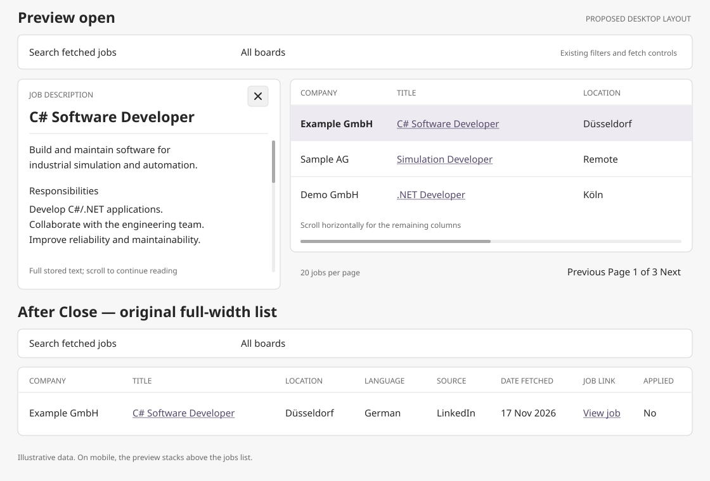
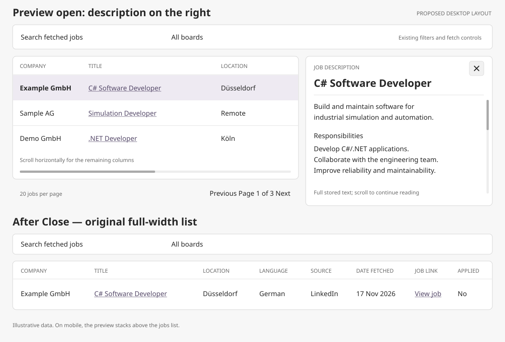

# Job description preview implementation plan

Status: proposed; implementation has not started.

## Behavior

- Make each title in **Available Jobs** a keyboard-accessible button styled as a link.
- Clicking a title opens an in-page panel on the **left**, showing the title and full stored description; the jobs table stays on the **right**. The existing external job link keeps its current behavior.
- Clicking another title replaces the preview. A **Close** button or Escape closes it and restores the full-width table, current filters, page, scroll position, and user-adjusted column widths. Return keyboard focus to the selected title when available.
- Display plain text safely, preserving line breaks and wrapping long content. Use a scrollable description area and show “No description available” for empty descriptions. “Full” means all text already fetched and stored; opening a preview does not fetch the source website.

## Proposed defaults

- Desktop: approximately **40% preview / 60% jobs**, with horizontal scrolling inside the table when needed; keep all existing columns.
- At widths of **700px or less**, stack the preview above the existing mobile jobs layout.
- Keep filters and fetch controls above the split; pagination stays with the jobs list.
- On a successful list refresh, update the preview if the selected job remains in the results; otherwise close it. Clear the preview when leaving Available Jobs.

## Graphical preview

Schematic only: the open table shows a subset of columns to illustrate its scrollable viewport. All existing columns remain available.

## Implementation steps

1. **Expose the stored description.** Add `description` to `AvailableJobModel.to_list_item()` in `app/database_models.py`, following the existing constant conventions. The repository query already reads it, so no migration or new endpoint is needed. Reuse `/api/available-jobs`; retain the current page's items by ID in the UI.
2. **Add the layout.** Update `templates/available_jobs.html` and `static/app.css` with a hidden preview region, title, Close button, scrollable text, and responsive split container. Match existing theme variables and focus styles.
3. **Connect interactions.** Update `static/available_jobs.js` for title activation, selected-job state, safe `textContent` rendering, close/Escape handling, and refresh behavior. Preserve the table's column-width proportions across split changes; restore its pre-open widths on close. Integrate navigation cleanup in `static/app.js` and update affected asset version tokens in `templates/index.html`.
4. **Verify.** Check the API returns complete and empty descriptions. Check open/switch/close, keyboard focus, long text, HTML-like text rendered literally, filters/pagination, navigation, desktop/mobile layouts, and column resizing/restoration. Extend the existing API test and add focused UI regression coverage for selection and restoration behavior.

## Clarifications

No blocking questions. The split ratio, mobile stacking, and refresh behavior above are proposed defaults for review.

## Change history

- **2026-11-17 12:30 CET** — Created the initial plan and graphical preview from `job_description_view_specs.md` and the current implementation. Future updates will be appended below with timestamps; later entries supersede earlier decisions.

### Update — 2026-11-17 12:37 CET

- Replace the visible **Close** button text with an **× icon** in the behavior and layout described above. Use an icon-only button with `aria-label="Close job preview"` and a matching tooltip; keep keyboard activation, Escape, and focus restoration unchanged.
- Updated the graphical preview to show the icon button. This supersedes the earlier text-button design; implementation has not started.

### Alternative preview — 2026-11-17 12:43 CET

- Added a comparison layout with the **jobs table on the left (60%)** and the **description on the right (40%)**, keeping the icon-only close button. The original preview remains available; the side choice is pending review.

### Confirmed layout — 2026-11-17 12:45 CET

- The right-side preview is the selected design: **jobs table on the left (60%)**, **job title and full description on the right (40%)**.
- Keep the **× icon-only close button**, with “Close job preview” as its accessible label and tooltip. Closing restores the full-width jobs table.
- Use [the right-side graphical preview](job_description_view_preview_right.svg) as the implementation reference. The earlier left-side layout is retained only for history; the side choice is no longer pending.
- This decision supersedes the earlier left/right placement in Behavior and applies to the layout implementation step. All other planned behavior remains unchanged. Implementation has not started.

### Implementation completed — 2026-11-17 13:01 CET

- Implemented the selected **60% jobs / 40% right-side description** layout, clickable titles, the **×** close button, Escape, focus restoration, and mobile stacking. Closing restores the previous column widths and scroll position without resetting filters or pagination.
- The existing jobs API now returns the full stored description. Text is rendered literally with preserved line breaks; empty descriptions show a fallback message. No database migration or additional source fetch is required.
- Added `static/job_description_preview.js` for preview state and interactions. Navigation cleanup uses the existing `CvUi.registerView` lifecycle, so `static/app.js` required no modification. Updated the relevant asset versions.
- Validation: **25 Python tests and 9 JavaScript tests passed**. Browser checks with isolated sample data verified opening/switching/closing, Enter/Escape, exact resized-column restoration, empty and HTML-like descriptions, filter removal, navigation cleanup, and the 390px mobile layout. One pre-existing FastAPI/Starlette deprecation warning remains.
- [Implemented desktop screenshot](job_description_view_implemented.jpg). Earlier “implementation has not started” notes are historical; this entry records completion. No outstanding clarification is needed.

### Simplified preview table — 2026-11-17 13:49 CET

- Hide **Language, Source, and Date Fetched while the description preview is open**, including on mobile. Keep Company, Title, Location, Job link, and Applied visible. Closing restores all eight columns and their previous widths.
- Column sizing now distributes space only among visible columns. This supersedes the earlier requirement to keep all columns visible beside the description; stored data and API fields remain unchanged.
- Verified with **7 passing JavaScript tests** and desktop/mobile browser checks, including exact width restoration. [Updated screenshot](job_description_view_compact.jpg).
