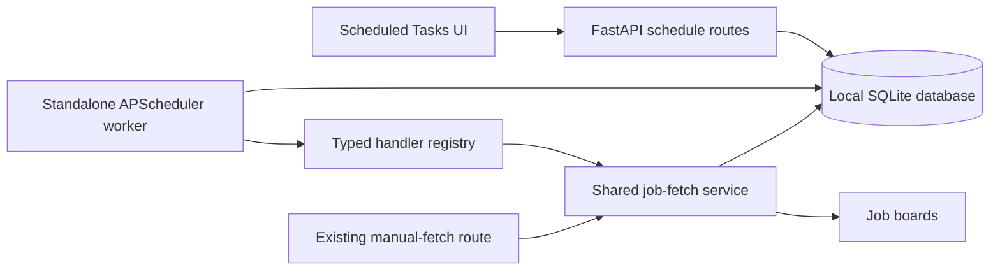

# ApplyKit task scheduler roadmap

Status: planned. Prepared 2026-10-31. These documents define future work; they do
not install dependencies, start services, or implement the scheduler.

## Outcome and first release

Run scheduled tasks in a dedicated process that keeps working when the browser
and FastAPI application are closed. Users manage schedules through ApplyKit and
see their next run, last result, and execution history. The first task type fetches
jobs using an existing saved search and selected boards. Future task types plug
into a typed handler registry without rewriting the scheduling service.

First-release features:

- Create, list, edit, pause, resume, and delete schedules; request a run now.
- Interval schedules and one-time schedules, with an explicit first execution
  time. Intervals are elapsed time, not local calendar appointments.
- Persistent definitions, execution records, worker health, and restart recovery.
- Reuse existing job fetching, filters, result limits, partial-success behavior,
  and duplicate-posting prevention.
- A Scheduled Tasks screen, alongside focused backend and UI refactoring.
- A foreground worker command plus a documented Windows startup procedure.

Deferred: arbitrary cron expressions, local-calendar daily/weekly rules, automatic
retry policies, multiple worker hosts, distributed queues, arbitrary Python/shell
tasks, new job-board scrapers, and migration of Jira coding automation. A 24-hour
interval may shift its local clock time at daylight-saving transitions; the UI
must say “Every 24 hours,” not “Daily at 09:00.”

## Current implementation and required seams

| Existing component | Observed behavior | Planned change |
| --- | --- | --- |
| [app/main.py](../../app/main.py) | Owns FastAPI startup, migrations, and many unrelated routes. | Add only scheduler router wiring; no scheduler starts in its lifespan. |
| [app/job_search.py](../../app/job_search.py) | Contains router, service, outcome, and lazy scraper loader; outcome raises HTTP errors. | Extract transport-independent fetching and errors, preserve the HTTP contract. |
| [app/job_search_repository.py](../../app/job_search_repository.py) | SQLAlchemy persistence; raises HTTP errors for missing/deleted preferences. | Use domain errors and existing transaction/upsert behavior. |
| [app/database.py](../../app/database.py) and [migrations](../../app/db_migrations/__init__.py) | Fixed database path; startup applies versions 1–4. | Shared path configuration and serialized migration startup for two processes. |
| [app/job_search_glassdoor.py](../../app/job_search_glassdoor.py) | Thread-local-process lock and five-minute process-local cooldown. | Share exclusion and persisted cooldown between manual and scheduled fetches. |
| [app/request_logging.py](../../app/request_logging.py) | Rotates a single application log; defaults to TRACE. | Give the worker its own log file and INFO default. |
| [static/app.js](../../static/app.js), [templates/index.html](../../templates/index.html) | Shared globals, navigation, API utility, and page startup. | Extract shared utilities and a small view lifecycle before adding the new page. |
| [static/available_jobs.js](../../static/available_jobs.js) | Manual fetch and stored-job browsing. | Preserve both flows; scheduled jobs appear through existing listing. |
| [coding_agent/jira_agent/requirements.txt](../../coding_agent/jira_agent/requirements.txt) | Already pins APScheduler 3.11.3 in a separate automation. | Use a separately declared application scheduler dependency; do not couple lifecycles. |

The backend refactor is deliberately limited to job fetching and scheduler
integration. Moving application editing, templates, profiles, and LLM generation
out of `app/main.py` is a later effort, not a prerequisite for scheduling.

## Architecture decision

Use an independently launched `app.scheduler` package in this repository, sharing
the application's environment, models, and database. Proposed entry point:
`python -m app.scheduler`. It must not import `app.main`, run a web server, or call
the application's HTTP endpoints. Independent operation means a separate process,
not a separate copy of business logic or a separate application database.

Use the APScheduler 3.x API, initially targeting the already-used 3.11.3 pin;
SCH-01 must verify compatibility with the application's Python and dependencies.
A `BlockingScheduler` runs one short dispatch job every five seconds, with
`coalesce=True` and `max_instances=1`. Business work runs in a separate bounded
executor so a slow scraper cannot block dispatch or health updates. APScheduler's
memory job store holds only this dispatcher. Application schedule and run tables
are the durable source of truth; there is no second serialized schedule store.
The scheduler choice and dispatcher options follow the
[APScheduler 3.x guide](https://apscheduler.readthedocs.io/en/3.x/userguide.html).

The API only writes domain records, never APScheduler internals. This avoids
sharing an APScheduler job store between web workers and the worker process,
which the [APScheduler FAQ](https://apscheduler.readthedocs.io/en/3.x/faq.html)
explicitly disallows. Polling introduces up to one dispatch interval of normal
latency; this is not a real-time scheduler.

Acquire an OS-backed exclusive lock keyed by the resolved database path before
worker startup, and retain it until all workers stop. A second worker exits
clearly. A PID file alone is insufficient. SCH-01 selects and pins a tested
Windows-compatible lock implementation. Local disk and one machine are the
supported deployment; network shares and multi-host workers are out of scope.

## Schedule and execution contract

Proposed defaults below are design decisions for SCH-01 to freeze, not claims
about existing behavior:

- Names: trimmed, 1–120 characters. Maximum 100 nondeleted schedules.
- Task type: `fetch_jobs`, payload version 1, `preference_id`, distinct supported
  `sites`, and `results_wanted` (1–1000; default 50). Reuse `JobSearchInput`
  validation and supported boards, including existing location restrictions.
- Trigger: `interval` with 300–31,536,000 seconds and a future `starts_at`, or
  `once` with a future `run_at`. Require offset-bearing timestamps, normalize
  to UTC, and return ISO 8601 with `Z`. Reject naive times and unknown fields.
- New schedules are enabled by default and never run before their selected time.
  Read current saved-search criteria at execution start, recording a snapshot
  in the run. Edits affect future runs; an active run keeps its captured input.
- Edits require the current revision and increase it atomically. A changed
  trigger starts from its newly supplied future anchor. Payload/name changes
  preserve the existing due time. Pause clears eligibility; resume advances an
  interval to its next future occurrence without replay. An overdue paused
  one-time task requires a new future time before resuming.
- The next interval occurrence is computed from the original UTC anchor, not
  completion time. On downtime, coalesce missed occurrences to the latest one;
  run it only if at most 300 seconds late, otherwise record one `missed` summary
  with the skipped count and advance. An expired one-time schedule records
  `missed` and becomes disabled. This policy is implemented in the dispatcher;
  APScheduler's dispatcher misfire settings alone do not persist business timing.
- At most one queued/running execution per schedule; default global worker
  concurrency is two. If capacity is full, leave due records unclaimed and
  re-evaluate lateness on the next tick. An already active schedule produces a
  `skipped_overlap` summary and advances past its due occurrences.
- Run now is allowed for enabled or paused schedules, leaves future recurrence
  unchanged, and does not resume a paused schedule. It requires an idempotency
  key, permits only one active request per schedule, and expires after 300
  seconds without a worker. An accepted request is not evidence of execution.
  Completing a manual run on a one-time schedule does not consume its separately
  scheduled occurrence; completing the timed occurrence disables that schedule.
- No automatic retries in this release. The next recurring occurrence is a new
  run. Manual re-execution is explicit; partial-success warnings remain visible.
- Pause/delete prevents future claims. Delete is a tombstone and active work
  may finish. Already-claimed runs are not cancelled; the response/UI says so.
  A disabled/deleted task type cannot invoke arbitrary imports or commands.

Claim, create the run snapshot, and advance the next due time in one short
SQLite transaction. A uniqueness constraint on `(schedule_id, revision,
scheduled_for)` prevents duplicate timed claims; manual requests have a separate
idempotency key. Transaction boundaries serialize claims against edit/pause/delete.
Network calls occur only after commit. Atomically transition a queued run to
running after a final state check: deletion or a changed revision cancels a
pending claim; a paused schedule prevents a timed claim from starting. An
explicit manual request created against the current paused revision may start.
Later edits cannot cancel a run that already crossed this boundary.

The claim snapshot captures the schedule payload/revision. Immediately before
scraping, the handler adds the effective saved-search criteria read at execution
start. Keep these two snapshots distinct so a preference edit between claim and
execution is visible rather than silently rewriting the claimed task definition.

State transitions: `queued -> running -> succeeded | partial | failed`;
`queued -> cancelled | missed`; and `queued | running -> interrupted` after a
worker restart. `missed` and `skipped_overlap` can also be created as terminal
dispatch records. After acquiring the singleton lock, recovery marks unfinished
old-owner runs interrupted and does not replay them. A crash after results are
saved but before the run completes may leave an interrupted run with stored
jobs: no exactly-once claim is made. Existing posting upserts limit duplication.

Deleting a saved search referenced by a nondeleted schedule returns HTTP 409
with affected schedule IDs; deleting those schedules first allows the existing
operation. Recheck preference existence at fetch start and persistence, retaining
the current safe failure if it disappears during a run. Completed history keeps
its input snapshot even when a preference or schedule is later deleted.

## Persistence and extension points

All new tables have mapped classes and versioned migrations. Allocate the next
available version at integration time; version 5 is only the current candidate.

| Proposed table/model | Required contents |
| --- | --- |
| `task_schedules` / `TaskScheduleModel` | Identity, name, task type/payload version, validated JSON payload, optional preference FK, trigger fields, enabled/deleted flags, revision, next due time, creation/update times. |
| `task_runs` / `TaskRunModel` | Schedule/revision, occurrence or manual key, input snapshot, state, owner token, scheduled/queued/start/end times, safe error code/message, per-board results and counts. |
| `scheduler_workers` / `SchedulerWorkerModel` | Stable worker slot, ownership token, process metadata, heartbeat, startup/shutdown state. Health only; not the ownership lock. |
| `job_board_state` / `JobBoardStateModel` | Board identity and persisted cooldown deadline, shared by manual and scheduled fetches. |

Index enabled next-due schedules and run history by schedule/time. Keep failed
and interrupted records for 90 days by default; prune all terminal history in
bounded batches using a configurable retention period, never active runs. Retain
manual idempotency keys with their runs and document the resulting 90-day dedupe
window. Tombstones referenced by retained history remain available.

Use `BaseTaskHandler`, `BaseScheduleRepository`, `BaseClock`, and an injected
executor interface at genuine substitution boundaries. `FetchJobsTaskHandler`
delegates to the shared `JobSearchService`. A future handler adds its payload
schema, handler class, registry entry, result model, tests, and optional form;
there is no user-supplied callable, module path, SQL, or script execution.

Use SQLAlchemy expressions and mapped models, not handwritten data queries.
Follow [AGENTS.md](../../AGENTS.md): explicit object-oriented Python, descriptive
names, docstrings for every class/function, comments for important logic, and
`C_` constants (vendor-specific prefixes where appropriate).

## Management API and UI

Proposed API prefix: `/api/task-schedules`.

| Route | Result |
| --- | --- |
| `GET /api/task-schedules` | Paginated schedules, enabled state, revision, next due time, latest run summary. |
| `POST /api/task-schedules` | Validate and persist definition; 201 with full schedule. |
| `GET /api/task-schedules/{id}` | Definition and current revision; 404 if deleted/missing. |
| `PUT /api/task-schedules/{id}` | Replace editable fields with expected revision; 409 on conflict. |
| `POST /api/task-schedules/{id}/pause` or `/resume` | Revision-checked state change with active-run indicator. |
| `DELETE /api/task-schedules/{id}?revision=...` | Tombstone with revision check; 204; active work may finish. |
| `POST /api/task-schedules/{id}/run-now` | Idempotent request; 202 with run ID, or 409 if different work is already active. |
| `GET /api/task-schedules/{id}/runs` | Paginated execution history; retained history remains readable for a deleted schedule. |
| `GET /api/scheduler/status` | Fresh/stale/stopped worker state, heartbeat, queue/running counts. |

List envelopes use `items`, `total`, `page`, `page_size`, `total_pages`;
page sizes 1–100, default 20. Invalid inputs return 422, absent records 404,
conflicts 409, and transient storage failure 503. SCH-01 freezes detailed schemas
and examples, including a stable error-code field. Worker freshness threshold is
30 seconds. Schedule editing works while the worker is offline; show an offline
warning for run-now requests instead of claiming the job has started.

Keep the current local-only deployment model; no new public service port is
required. External-host access/authentication is a separate deployment decision.

Refactor shared HTTP/error utilities and navigation into small scripts with
explicit initialization and view enter/leave hooks. Preserve compatibility for
existing pages until they migrate. No frontend framework or build system is
required. A new `scheduled_tasks` script/template/style owns form state, schedule
listing, history, and status polling; stop polling on navigation and ignore stale
responses. Normalize dates without appending a second `Z` to scheduler timestamps.

Show saved-search and board choices, name, frequency/start time, result limit,
next execution with timezone, pause/resume, run now, and deletion confirmation.
Display failed/partial/missed/interrupted states distinctly and preserve errors
until acknowledged or superseded. Escape user-controlled names and warnings;
include keyboard access, labels, loading/empty/offline states, and both themes.

## Reliability and operation

Manual and scheduled searches share an OS-backed per-board lock and persisted
Glassdoor cooldown. Use nonblocking board-lock acquisition and return a board
busy warning rather than consuming all worker capacity waiting. Existing
successful boards still persist. Cross-process coordination is required before
release, not an optional follow-up.

Serialize migration startup with a separate short-lived database-specific lock,
shared by FastAPI and the worker; never alter deployed migration history. Set
explicit bounded SQLite lock waits and report temporary contention. Keep network
work outside database transactions. Test concurrent startup on Windows.

Worker logs go to `scheduler.log`, with identifiers and durations at INFO; avoid
full job payloads, descriptions, and personal data. Separate rotating files avoid
two processes rotating `applykit.log`. Record dispatch failure separately from
task failure. Heartbeat must stop being fresh when the dispatch loop stops.

On shutdown stop claims, drain running work, close resources, then release the
singleton lock. Python threads cannot forcibly stop a blocked scraper: document
this limit, require bounded network settings where supported, and define a
supervisor grace period before forced process-tree termination. A restart marks
abandoned runs interrupted. Do not claim that an executor timeout cancels scraping.

## Implementation tasks and dependency order

All tasks are pending. Estimates are hands-on planning ranges, excluding live
board troubleshooting. Dependency IDs are completion gates, not just suggested
reading. Independent branches may use contract fixtures before integration.

| Task | Deliverable | Depends on | Estimate |
| --- | --- | --- | --- |
| [SCH-01](tickets/SCH-01.md) | Freeze contracts and configuration | None | 0.5–1 day |
| [SCH-02](tickets/SCH-02.md) | Extract reusable job-fetch backend | SCH-01 | 1–2 days |
| [SCH-03](tickets/SCH-03.md) | Persistence, migrations, repository | SCH-01 | 1.5–2.5 days |
| [SCH-04](tickets/SCH-04.md) | Independent APScheduler runtime | SCH-03 | 1.5–2.5 days |
| [SCH-05](tickets/SCH-05.md) | Job-fetch handler and board coordination | SCH-02, SCH-03 | 1–2 days |
| [SCH-06](tickets/SCH-06.md) | Schedule management API | SCH-02, SCH-03 | 1–2 days |
| [SCH-07](tickets/SCH-07.md) | Extract UI utilities and lifecycle | SCH-01 | 1–2 days |
| [SCH-08](tickets/SCH-08.md) | Scheduled Tasks screen | SCH-07 | 1.5–2.5 days |
| [SCH-09](tickets/SCH-09.md) | Recovery, health, logging, retention | SCH-04, SCH-05 | 1–2 days |
| [SCH-10](tickets/SCH-10.md) | End-to-end and concurrency verification | SCH-06, SCH-08, SCH-09 | 1.5–2.5 days |
| [SCH-11](tickets/SCH-11.md) | Windows operation and rollout guide | SCH-09 | 0.5–1 day |
| [SCH-12](tickets/SCH-12.md) | Integration and release acceptance | SCH-10, SCH-11 | 0.5–1 day |

Total: approximately 13–23 person-days. Parallel work reduces elapsed time but
does not remove contract, integration, or review work.

Suggested waves:

1. SCH-01 establishes stable interfaces and fake fixtures.
2. SCH-02, SCH-03, and SCH-07 proceed independently.
3. SCH-04, SCH-05, SCH-06, and SCH-08 proceed independently once their own
   prerequisites finish. SCH-08 uses API fixtures; live wiring is checked later.
4. SCH-09 follows runtime/handler integration.
5. SCH-10 and SCH-11 proceed independently.
6. SCH-12 validates the complete release.

See the [coding-agent guide](coding_agent_execution.md) for ownership boundaries,
isolated checkout recommendations, prompts, and handoff rules.

## Acceptance and rollout

Use temporary databases and fake scrapers throughout automated verification.
Required release evidence: fetch with FastAPI stopped; persistence across restart;
second worker rejected; no duplicate timed/manual claim; concurrent API edits;
pause/delete races; overdue/coalesced execution; one-time completion; partial
board failure; cooldown shared with manual fetch; safe migration from version 4;
and browser regressions for navigation, themes, and Available Jobs.

Stop both processes and back up the SQLite database before the first upgrade.
Validate on a disposable copy, apply additive migrations, start the web app,
create a paused schedule, then start the worker and enable a controlled schedule.
Use a fake handler first; live board access is an optional explicit smoke test.

To disable scheduling, stop the worker and pause schedules. To roll back code,
stop both processes and restore a matching pre-upgrade database and application
version: the current migration runner rejects unknown versions, so an older app
cannot simply reopen an upgraded database. Restoration loses post-backup changes;
prefer a forward fix when preserving those changes matters.

## Assumptions to revisit before coding

No further answer is needed to use this plan. Defaults are a single local machine,
shared code/environment/database, interval and one-time scheduling, no automatic
retry, 90-day history, and Windows user-session startup. If “service” requires
execution before user login, or if schedules must follow a fixed local clock
time across daylight-saving changes, revise SCH-01 and deployment acceptance
before implementation. These are extension decisions, not silently implemented
requirements.
